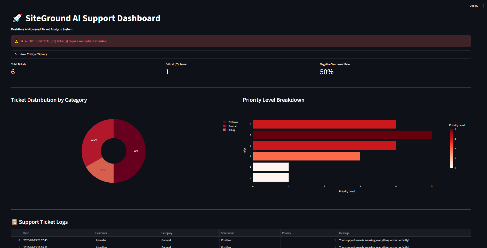
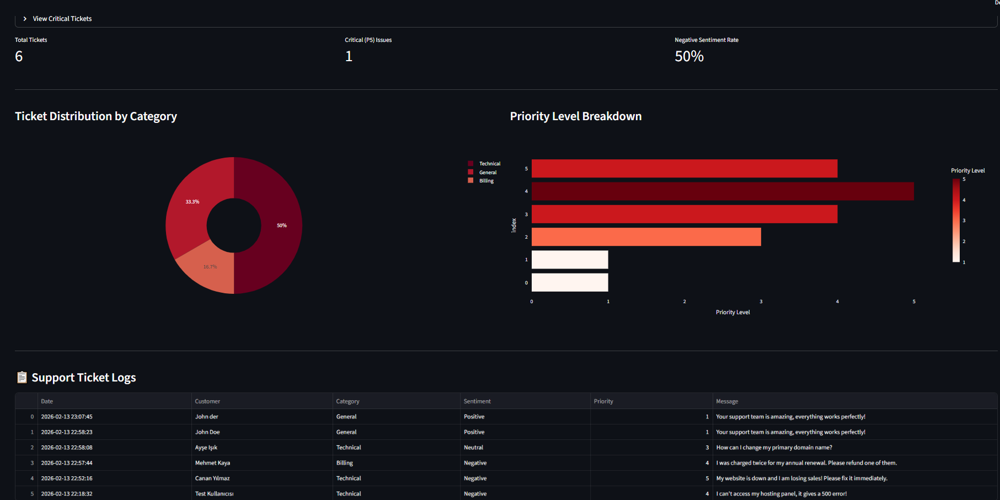

# AI Support System 🚀

An end-to-end AI-powered support ticket management system designed to categorize, analyze sentiment, and prioritize customer inquiries in real-time.

## 🌟 Key Features
- **AI Analysis:** Uses LLM (Llama-3 via Groq) to extract category, sentiment, and priority from raw text.
- **FastAPI Integration:** Professional REST API for ticket submission and processing.
- **PostgreSQL Storage:** Relational database for persistent storage and data integrity.
- **Real-time Dashboard:** Streamlit-based executive panel for monitoring critical tickets and trends.

## 🛠 Tech Stack
- **Backend:** Python, FastAPI
- **AI:** Llama-3 (Groq API)
- **Database:** PostgreSQL, SQLAlchemy
- **Frontend/BI:** Streamlit, Plotly
- **DevOps:** Dotenv, Virtual Environments

## 🚀 Getting Started
1. Clone the repository.
2. Install dependencies: `pip install -r requirements.txt`
3. Configure your `.env` file with `GROQ_API_KEY` and `DB_URL`.
4. Run the API: `uvicorn api:app --reload`
5. Launch the Dashboard: `streamlit run dashboard.py`

## 📊 Business Logic
The system automatically identifies **Priority 5 (Critical)** tickets (e.g., website down, loss of revenue) and flags them for immediate action on the dashboard to reduce churn.

## 📊 System Preview

